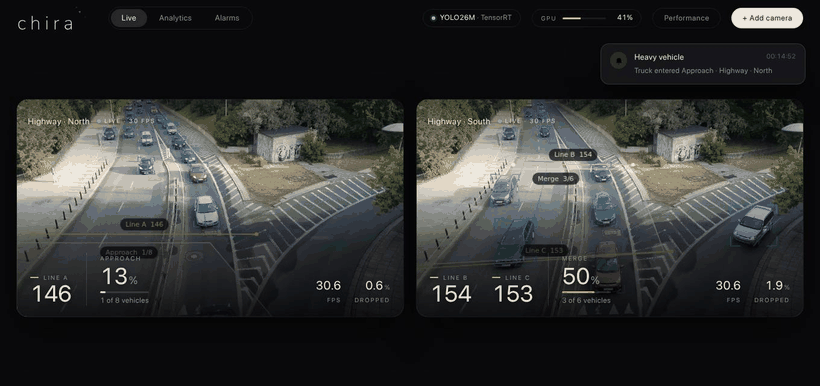
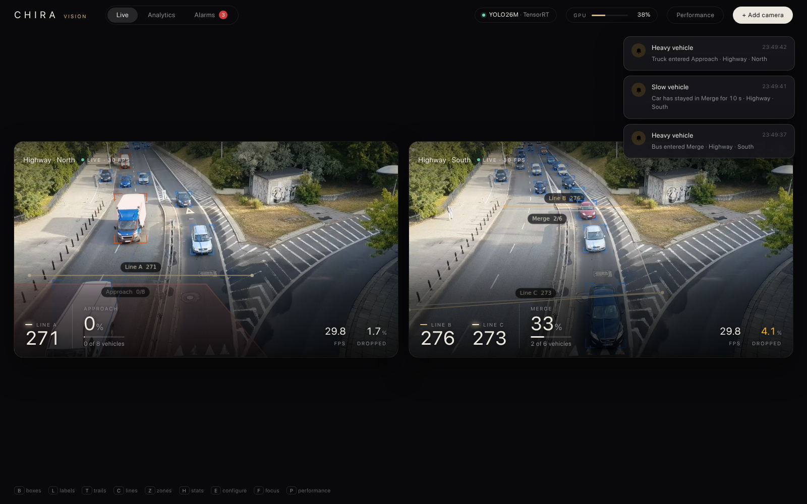
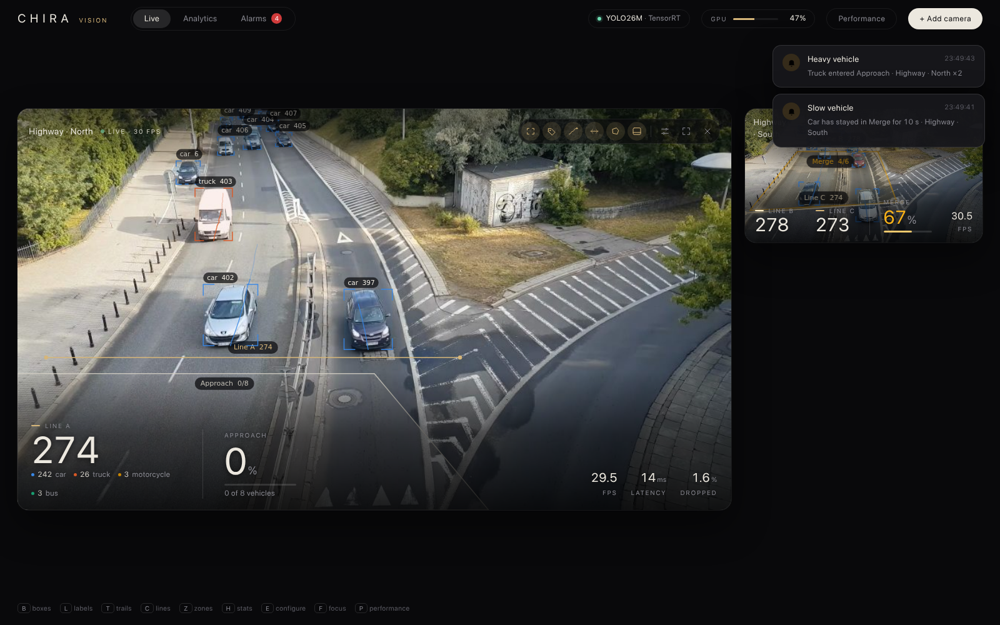
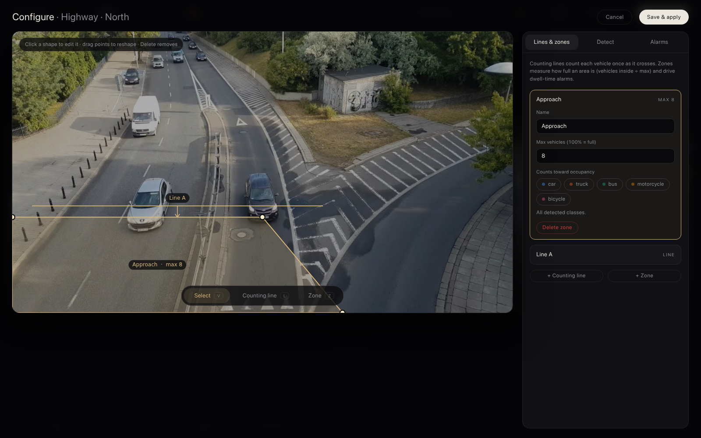
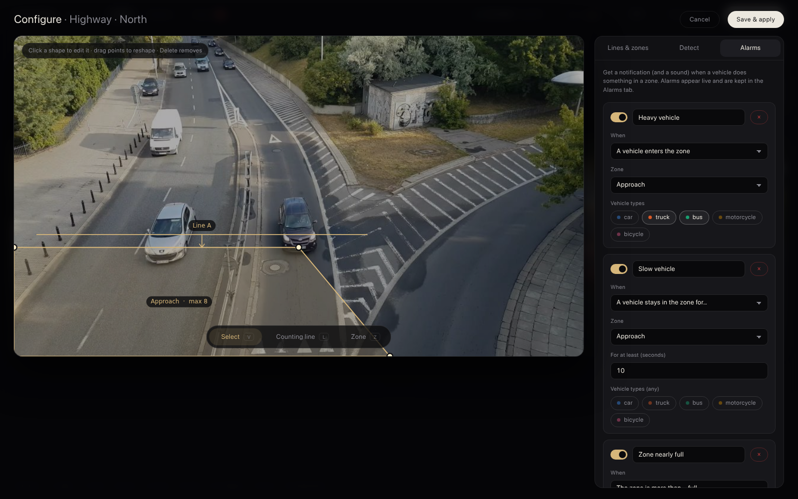
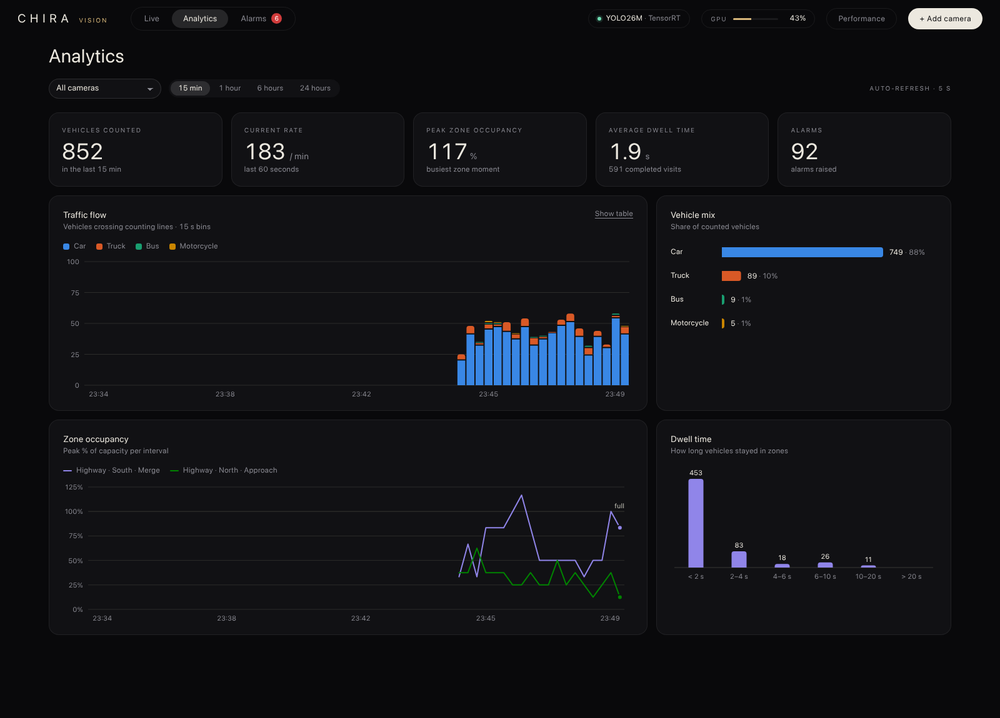
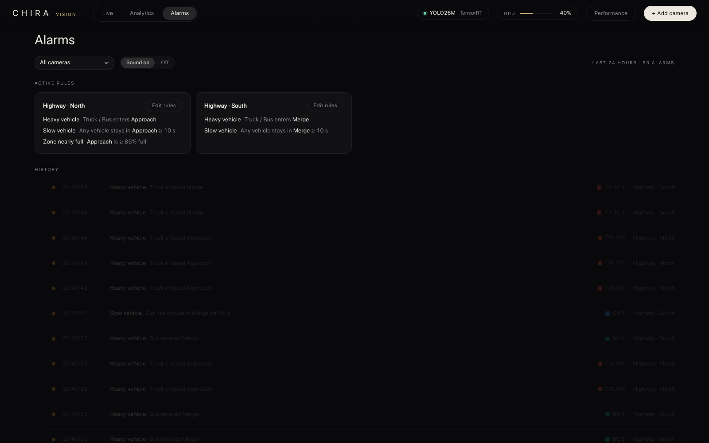
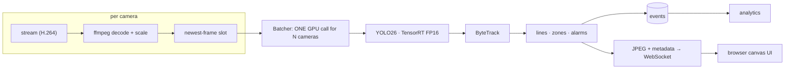

<div align="center">

# 𝐂𝐇𝐈𝐑𝐀

**Many cameras. One GPU. Zero GIL.**
Real-time multi-camera detection, tracking, counting, zones and alarms, written in Rust.




</div>

*Chira* (ちら) is the Japanese sound of a quick glance. This is a from-scratch Rust rewrite of the core of an older Python/YOLOX
tracking service, built around one question: **what happens to FPS when you add camera #2, #3, #8?** In Python every extra camera
slowed the others down while the GPU sat half idle (the GIL). Here every camera is a set of native threads sharing a single batched
GPU call.

|  | 3 cameras @ 30 fps, same model | dropped frames |
|---|---|---|
| Python (original pipeline) | **22 fps** per camera | 26 % |
| **Chira** | **30 fps** per camera | < 1 % |

And with YOLO26 + TensorRT it keeps **8 cameras at ~29 fps each** (YOLO26-S) or **6 at ~30 fps** (YOLO26-M) on a mid-range RTX 2060.
Details and caveats in [docs/RESEARCH.md](docs/RESEARCH.md).

## What it does

- **Detect, track, count.** YOLO26 (FP16, TensorRT) → ByteTrack → lines that count each object once, per class and direction.
- **Zones with capacity.** Draw a polygon, say "max 8 vehicles", and watch it fill: live `% consumed` meter, tinted by how full it is.
- **Alarms.** Per zone or line: *enters*, *leaves*, *stays for ≥ N s*, *zone ≥ N % full*, *crosses a line*, filterable by object class.
  Live toast + sound + the zone flashes red. (Webhooks: not yet.)
- **Configure in the browser.** Draw lines and polygons on a frozen frame, pick which object classes matter, save: it hot-applies to the
  running camera, no restart.
- **Analytics.** Traffic flow by class, class mix, zone occupancy over time, dwell-time distribution, KPIs. Events persist across restarts.
- **Fast UI.** Overlays are drawn on a screen-resolution canvas in a handful of batched calls; only the newest frame is ever drawn.

## Screenshots

<table>
<tr>
<td width="50%"><br><sub><b>Live</b>: two cameras, counting lines, zone occupancy, a live alarm</sub></td>
<td width="50%"><br><sub><b>Focus mode</b> with labels (every control is a toggle)</sub></td>
</tr>
<tr>
<td><br><sub><b>Configure</b>: draw lines and zones, set capacity and classes</sub></td>
<td><br><sub><b>Alarm rules</b>: enter / leave / dwell / occupancy / cross</sub></td>
</tr>
<tr>
<td><br><sub><b>Analytics</b>: flow, mix, occupancy, dwell time</sub></td>
<td><br><sub><b>Alarms</b>: active rules and history</sub></td>
</tr>
</table>

## Quick start

**Requirements:** Linux, an NVIDIA GPU (tested: RTX 2060) with CUDA 12 + cuDNN 9, `ffmpeg`, a recent Rust toolchain, Chrome/Firefox.

```bash
git clone https://github.com/GabrielDornelles/chira && cd chira

# 1. a model. Export YOLO26 to the ONNX interface Chira expects (uint8 frames in, top-300 boxes out)
pip install ultralytics onnx
python research/export_ultra_wrapped.py yolo26m.pt models/yolo26m_544x960.onnx     # or yolo26s.pt for more cameras

# 2. a "camera": any video file. It is streamed in real time, in a loop, like a live source
mkdir -p videos && cp /path/to/some/traffic_video.mp4 videos/demo.mp4

# 3. TensorRT libraries (optional but ~2x faster; skip with EP=cuda)
uv venv .trt-venv && VIRTUAL_ENV=.trt-venv uv pip install tensorrt-cu12-libs==10.9.0.34

./run.sh            # http://localhost:8787
```

The very first start compiles the TensorRT engines (a few minutes per batch size, cached in `trt_cache/`). The UI is available immediately
and shows the progress. Then click **+ Add camera**.

| env var | default | |
|---|---|---|
| `EP` | `trt` | `cuda` to skip TensorRT |
| `MODEL` | `models/yolo26m_544x960.onnx` | any model exported with the script above |
| `MAX_BATCH` | `4` (trt) / `8` | cameras batched per GPU call (TensorRT builds one engine per size) |
| `VIDEO` | `videos/demo.mp4` | the simulated camera source |
| `PORT` | `8787` | |

Keyboard (Live tab): `B` boxes · `L` labels · `T` trails · `C` lines · `Z` zones · `H` stats · `E` configure · `F` focus · `P` performance.

## How it works



- **No GIL, no shared state but the GPU.** Each camera is a handful of native threads. A camera never waits for the model: if the GPU is
  busy, its stale frame is dropped (and counted), exactly like a real camera would force you to.
- **One model, N cameras, one call.** The batcher stacks the newest frame of every camera into a single batch. (Surprise from the
  benchmarks: changing batch shape between calls costs ~150 ms in ONNX Runtime/cuDNN, so the shape is fixed to the camera count and only
  changes when you add or remove a camera.)
- **Pre- and post-processing live in the model graph.** The ONNX takes raw `uint8` frames and returns `[B, 300, 6]` boxes; layout/BGR/FP16
  conversion, box decode, class filter and top-K all run on the GPU. Only ~7 kB per frame comes back.
- **Live reconfiguration.** The inference thread rebuilds its counter, zone and alarm engines between frames when the config changes.

```
src/            Rust: detector (ORT + TensorRT), batcher, pipeline, tracker (ByteTrack), counter, zones, alarms, analytics, HTTP/WS server
static/         the UI: plain HTML/CSS/JS, no build step (served from disk, so edits show on refresh)
research/       model + tracker comparison scripts, ONNX export for Ultralytics models
bench/          Python-vs-Rust and multi-camera benchmark scripts
tools/          capture.py: regenerates the screenshots and GIF above
docs/           RESEARCH.md: all the measurements
```

## Models, trackers, research

I benchmarked 13 detectors (YOLOX, YOLO11, **YOLO26**, RF-DETR) and 6 trackers (ByteTrack, BoT-SORT, OC-SORT, HybridSORT, BoostTrack,
SFSORT) on a real traffic clip. Short version: **YOLO26-S matches YOLOX-M's accuracy at YOLOX-S speed, TensorRT doubles throughput, and for
a fixed camera ByteTrack is still as good as anything newer.** Full tables in [docs/RESEARCH.md](docs/RESEARCH.md).

## Status & ideas

Works today: everything above, on simulated cameras (a video file streamed in real time). Next:

- [ ] real RTSP/RTMP inputs (the decode side already reads any stream URL; only the demo publisher is simulated)
- [ ] webhooks / MQTT for alarms
- [ ] polygon-based counting (vehicles in/out of a zone), speed estimation
- [ ] persistence in SQLite instead of JSON lines
- [ ] smoother camera hot-add (a new camera briefly drops frames while the GPU batch resizes)

## Notes & licence

- No licence file yet. Note that **YOLO26 / YOLO11 weights and the Ultralytics export tool are AGPL-3.0**; the models are not
  included and are downloaded by the export script. YOLOX and RF-DETR (N-L) are Apache-2.0.
- The screenshots use a traffic clip from YouTube that is **not** in this repository; bring your own video.
- Credits: [Ultralytics YOLO26](https://github.com/ultralytics/ultralytics), [ByteTrack](https://github.com/ifzhang/ByteTrack),
  [ONNX Runtime](https://onnxruntime.ai) + [`ort`](https://github.com/pykeio/ort), [axum](https://github.com/tokio-rs/axum), [TensorRT](https://developer.nvidia.com/tensorrt).
